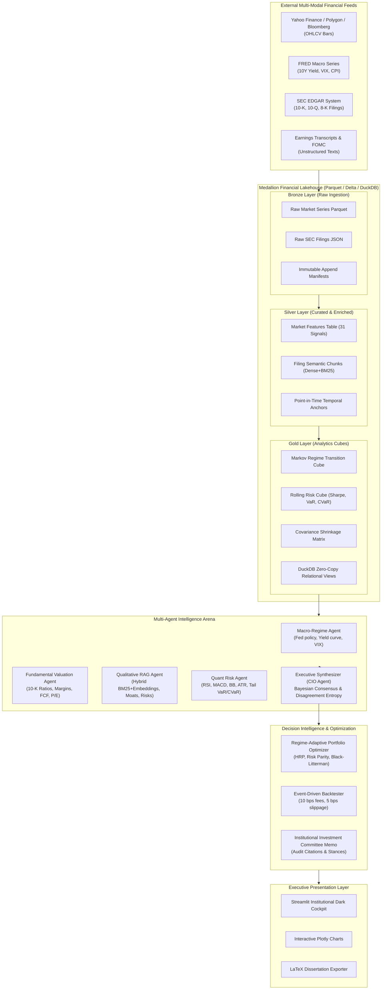

# FLAME-AI: System Architecture & Technical Specifications

This document outlines the end-to-end technical architecture, data flows, and schema contracts of the **FLAME-AI Financial Lakehouse & Agentic Intelligence System**.

---

## 1. High-Level System Architecture Diagram

---

## 2. Directory Layout & Module Responsibilities

| Path | Purpose & Responsibility |
| :--- | :--- |
| `configs/system_config.yaml` | Master system parameters, ticker universe, risk thresholds, RAG weights |
| `lakehouse/bronze_ingestion.py` | Ingests raw market bars and SEC documents into immutable Bronze partitions |
| `lakehouse/silver_transformation.py` | Computes 31 technical features, extracts tables, and creates semantic chunks |
| `lakehouse/gold_aggregations.py` | Materializes regime cube, risk metrics cube, covariance matrices & DuckDB views |
| `lakehouse/query_engine.py` | Zero-copy point-in-time SQL interface enforcing anti-lookahead causality |
| `rag/hybrid_retriever.py` | Dense-sparse hybrid search combining BM25 Okapi with semantic cosine embeddings |
| `rag/temporal_guardrail.py` | Audits retrieved chunks against decision dates; prevents information leakage |
| `rag/evaluation_metrics.py` | Calculates academic RAG metrics: Faithfulness, Answer Relevance, Precision, Recall |
| `agents/base_agent.py` | Base class with multi-backend LLM dispatcher and trajectory logging |
| `agents/macro_agent.py` | Analyzes macro liquidity, Fed rate stance, and regime stability |
| `agents/fundamental_agent.py` | Evaluates balance sheets, operating margins, ROE, and fair value multiples |
| `agents/qualitative_rag_agent.py` | Audits Item 1A Risk Factors and earnings transcripts with citation tracking |
| `agents/quant_risk_agent.py` | Computes technical momentum signals and 95%/99% VaR and CVaR stop-losses |
| `agents/executive_synthesizer.py` | CIO agent: Bayesian consensus weighting, entropy calculation, and memo formulation |
| `decision_intelligence/regime_detector.py`| Computes Markov transition probabilities and regime-conditioned risk envelopes |
| `decision_intelligence/portfolio_optimizer.py`| Implements HRP, Risk Parity, Black-Litterman, and adaptive switching |
| `decision_intelligence/backtester.py` | Realistic walk-forward execution engine with transaction costs and slippage |
| `evaluation/financial_metrics.py` | Computes CAGR, Volatility, Sharpe, Sortino, Calmar, MaxDD, VaR, CVaR, Alpha, Beta |
| `evaluation/agent_metrics.py` | Computes trajectory lengths, tool accuracy, and consensus entropy |
| `evaluation/benchmark_runner.py` | Conducts comparative multi-strategy ablation benchmarks |
| `ui/app.py` | Streamlit executive dark cockpit with 6 dedicated interactive research tabs |
| `ui/components.py` | Custom Plotly visualizations (radars, equity curves, donuts, heatmaps) |
| `ui/styles.css` | Glassmorphic dark styling, glowing badges, and institutional typography |
| `scripts/seed_lakehouse.py` | End-to-end data seeder for the Medallion pipeline |
| `scripts/run_experiments.py` | Executes full PhD empirical experiments and outputs comparison tables |

---

## 3. Database Schema Contract (DuckDB / Parquet)

### 3.1 `silver_market_features`
- `date`: `TIMESTAMP` (Index key)
- `ticker`: `VARCHAR` (Security identifier)
- `open`, `high`, `low`, `close`, `adj_close`: `DOUBLE` (Price bars)
- `volume`: `BIGINT` (Trading volume)
- `return_1d`, `return_5d`, `return_21d`, `return_63d`: `DOUBLE` (Log returns)
- `ema_14`, `ema_50`, `ema_200`: `DOUBLE` (Exponential moving averages)
- `rsi_14`: `DOUBLE` (Relative strength index)
- `macd`, `macd_signal`, `macd_hist`: `DOUBLE` (Trend convergence/divergence)
- `bb_upper`, `bb_lower`, `bb_zscore`: `DOUBLE` (Bollinger band statistics)
- `atr_14`: `DOUBLE` (Normalized average true range)
- `vol_10d`, `vol_21d`, `vol_63d`: `DOUBLE` (Annualized rolling volatilities)
- `drawdown`: `DOUBLE` (Drawdown from rolling cumulative peak)
- `spy_return_1d`, `alpha_21d`: `DOUBLE` (Cross-sectional benchmark relative signals)

### 3.2 `silver_filings_chunks`
- `chunk_id`: `VARCHAR` (Primary key)
- `doc_id`: `VARCHAR` (Filing accession number)
- `ticker`: `VARCHAR` (Company symbol)
- `company_name`: `VARCHAR` (Entity name)
- `doc_type`: `VARCHAR` (10-K, 10-Q, 8-K, Transcript)
- `filing_date`: `VARCHAR` (Point-in-time timestamp: YYYY-MM-DD)
- `section`: `VARCHAR` (Item 1, Item 1A, Item 7, Item 8)
- `content`: `TEXT` (Unstructured financial text)
- `is_tabular`: `BOOLEAN` (True if chunk contains financial statement tables)
- `embedding`: `LIST(FLOAT)` (256-dimensional dense normalized vector)

### 3.3 `gold_market_regimes`
- `date`: `TIMESTAMP` (Daily date anchor)
- `regime_id`: `TINYINT` (0: Bull, 1: Bear, 2: Crisis, 3: Sideways)
- `regime_name`: `VARCHAR` (Descriptive regime designation)
- `trend_strength`: `DOUBLE` (Benchmark moving average ratio)
- `market_volatility`: `DOUBLE` (Realized market volatility)
- `benchmark_close`: `DOUBLE` (Benchmark index close)
