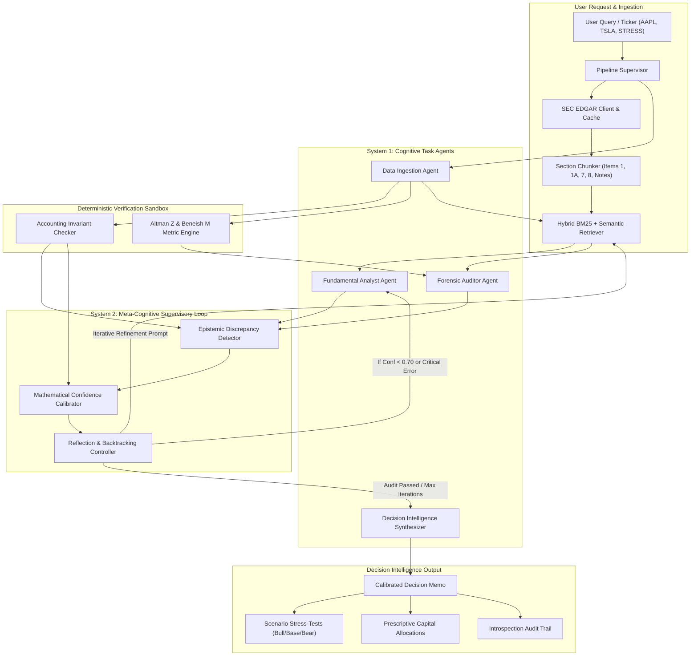

# System Architecture Specification

## Meta-Cognitive Agentic Framework for Adaptive Financial Analytics and Decision Intelligence

---

## 1. Component Specifications

### 1.1 Ingestion & Hybrid RAG Engine
- **SEC Client**: Interacts with the SEC EDGAR company facts API and submissions API. Uses persistent JSON caching in `cache/` to ensure offline reproducibility.
- **Section Chunker**: Respects regulatory boundaries (Form 10-K Items 1, 1A, 7, 8, and Footnotes). Never splits markdown tables across chunk boundaries.
- **Hybrid Retriever**: Combines Okapi BM25 sparse keyword scoring with dense cosine semantic similarity and regulatory section filtering.

### 1.2 Deterministic Verification Sandbox
- **Accounting Invariants**: Evaluates Balance Sheet equality ($A = L + E$), Gross Margin identity ($GP = Rev - COGS$), and Free Cash Flow identity ($FCF = OCF - Capex$).
- **Econometric Distress Model**: Altman Z-Score for non-financial corporations.
- **Earnings Manipulation Model**: 8-variable Beneish M-Score.

### 1.3 Meta-Cognitive Supervisory Layer
- **Epistemic Discrepancy Detector**: Scans qualitative claims from agent narratives and checks for dissonance with audited facts (e.g., negative cash flow vs. profitable narrative; compressed operating margin vs. margin expansion rhetoric).
- **Confidence Calibrator**: Mathematically penalizes verbalized confidence using the objective formula:
  $$\mathcal{C}^* = \min\left(C_{\text{raw}}, \alpha \cdot \mathcal{S}_{\text{grounding}} + \beta \cdot (1 - \Delta_{\text{pen}}) + \gamma \cdot \mathcal{S}_{\text{verif}}\right)$$
- **Reflection Controller**: Drives iterative re-querying when confidence is below 0.70 or critical discrepancies are uncovered.

### 1.4 Decision Intelligence Synthesizer
- Synthesizes an institutional-grade investment memo.
- Generates 3-state scenario stress tests (Bull, Base, Bear).
- Emits prescriptive capital allocation guidelines with position sizing and hedging advice.
